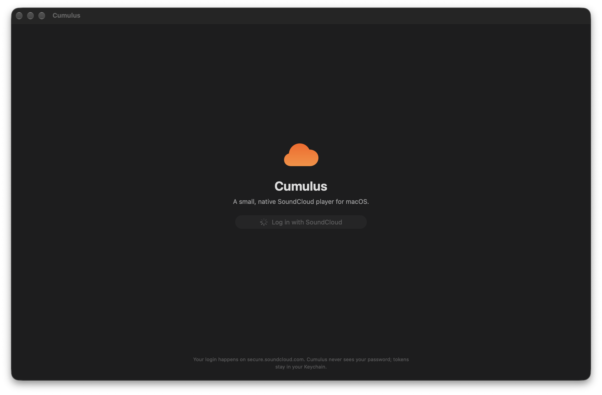

<div align="center">


# Cumulus

### A small, fast, **native** SoundCloud player for macOS

No web views. No Electron. No dependencies. Just a clean SwiftUI app that streams your SoundCloud — in **under 2 MB**.

<br/>


<br/>

### [⬇&nbsp; Download Cumulus.dmg](https://github.com/Kareem-3del/cumulus/releases/latest/download/Cumulus.dmg)

<sub>Universal · Apple Silicon & Intel · macOS 14+</sub>

<br/>



</div>

<br/>

## Why Cumulus

The SoundCloud website is heavy and the desktop options are Electron wrappers. Cumulus is the opposite: a real Mac app built entirely in SwiftUI on top of `AVPlayer`. It launches instantly, sips memory, and feels like it belongs on macOS — media keys, Control Center, a menu-bar mini player, and a one-click login that uses your normal browser.

<br/>

## Features

| | |
|---|---|
| **One-click login** | Sign in through your own browser where you're already logged in — no password ever touches the app. |
| **Home** | Recommendations built for you: Recently Played, Made for You, Popular in your genres, playlists & new tracks from people you follow. |
| **Song pages** | Open any track to see its stats, description, top comments, and a full list of **related / recommended songs**. |
| **Command palette** `⌘K` | Instant search across tracks, playlists and people — and jump to any section. |
| **Now Playing** `⇧⌘F` | Big artwork, a waveform scrubber, and SoundCloud's signature **timed comments** (click a timestamp to seek). |
| **Downloads** | Save any track to disk and play it back offline. |
| **Full player** | Waveform seek, shuffle, repeat, volume, speed `0.5×–2×`, a reorderable queue, autoplay of similar tracks, and a sleep timer. |
| **Your library** | Likes, playlists (create, edit, delete), liked playlists, your uploads, following, and history. |
| **Native macOS** | Media keys, Control Center / lock-screen controls, AirPods, a menu-bar mini player, and keyboard shortcuts throughout. |

<br/>

## Install

**The easy way —** [**download the latest `Cumulus.dmg`**](https://github.com/Kareem-3del/cumulus/releases/latest), open it, and drag **Cumulus** onto **Applications**. Then just click **Log in with SoundCloud** — no key or setup needed.

> First launch: because the app isn't notarized, right-click **Cumulus.app → Open → Open** the first time (macOS Gatekeeper asks once).

### Build it yourself

Requires macOS 14 (Sonoma) or newer and Xcode command-line tools.

```bash
git clone https://github.com/Kareem-3del/cumulus.git
cd cumulus
./build.sh install     # builds Cumulus.app and copies it to /Applications
./make-dmg.sh          # or package a drag-to-install DMG into dist/
```

### Set up login

Cumulus talks to the official SoundCloud API, which needs an app key.

1. Register an app at **[soundcloud.com/you/apps](https://soundcloud.com/you/apps)** and set its redirect URI to:
   ```
   cumulus://oauth/callback
   ```
2. Copy the template and fill in your credentials:
   ```bash
   cp secrets.env.example secrets.env
   # edit secrets.env → SC_CLIENT_ID, SC_CLIENT_SECRET
   ```
3. Rebuild with `./build.sh`. The key is compiled into the app, so everyone you share the build with just clicks **Log in** — no key or setup on their end.

Without a `secrets.env`, the app shows a one-time form to paste a key instead.

<br/>

## Keyboard shortcuts

| Shortcut | Action |
|---|---|
| `Space` | Play / pause |
| `⌘K` | Command palette (search everything) |
| `⇧⌘F` | Open Now Playing |
| `⌘←` / `⌘→` | Previous / next track |
| `⌥⌘←` / `⌥⌘→` | Skip 15 seconds |
| `⌘↑` / `⌘↓` | Volume up / down |
| `⌘L` | Like the current track |
| `⌘O` | Open a SoundCloud link |
| `⌥⌘U` | Toggle the queue |

<br/>

## Built with

- **SwiftUI** — the entire UI
- **AVFoundation** — streaming and downloads
- **AuthenticationServices / URL scheme** — OAuth 2.1 with PKCE
- **MediaPlayer** — Now Playing & remote controls
- Zero third-party packages

<br/>

## Tech notes

- Login is OAuth 2.1 + PKCE against `secure.soundcloud.com`, handed back to the app via the `cumulus://` URL scheme.
- Tokens and credentials live in the macOS **Keychain**; history, session and the downloads index live in `~/Library/Application Support/Cumulus/`.
- Downloaded audio goes to `~/Music/Cumulus/` (configurable in Settings).

<br/>

## Contributing

Issues and pull requests are welcome. The code is organized into `App`, `Core`, `Player` and `Views` under `Sources/Cumulus/`.

<br/>

## License

[MIT](LICENSE) © Kareem Adel

<br/>

<div align="center">
<sub>

**Cumulus is an unofficial, independent client.** It is not affiliated with, endorsed by, or sponsored by SoundCloud.
SoundCloud is a trademark of SoundCloud Global Limited & Co. KG.

</sub>
</div>
